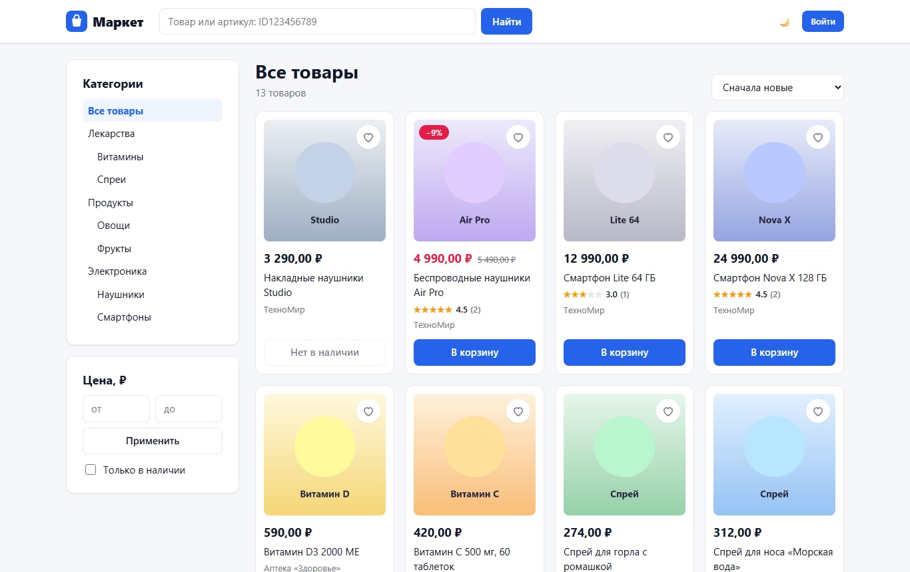
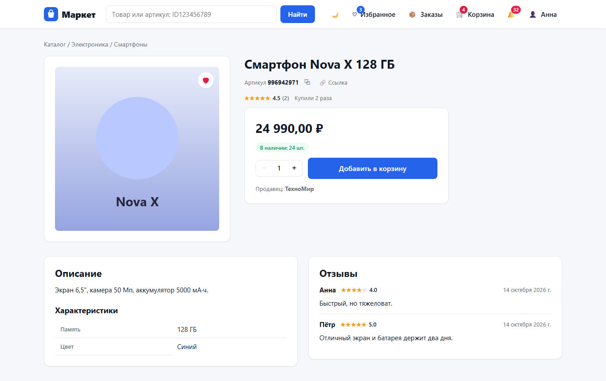
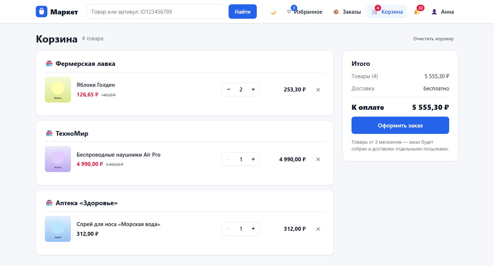
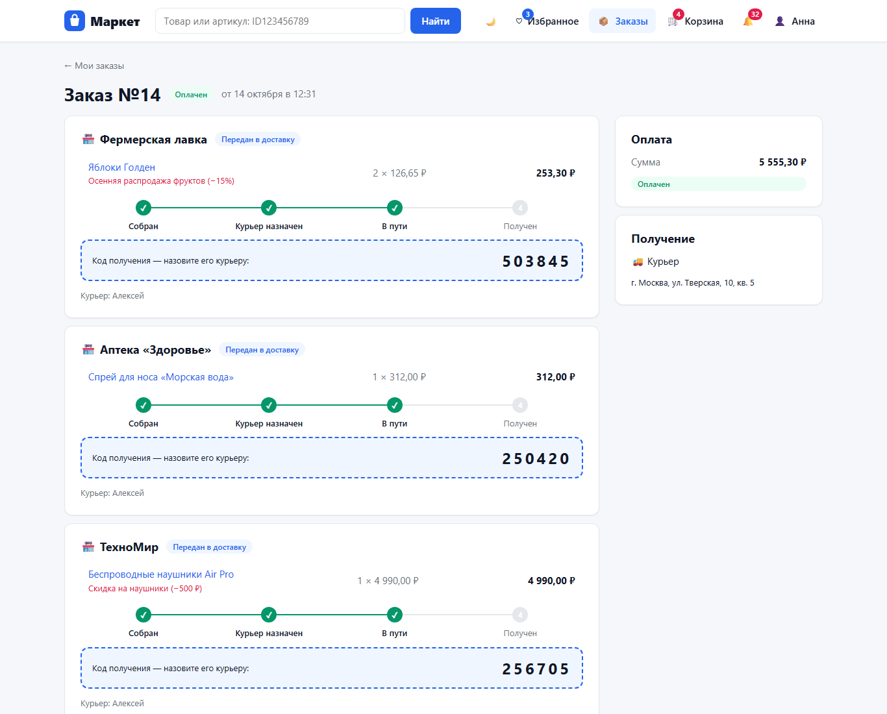
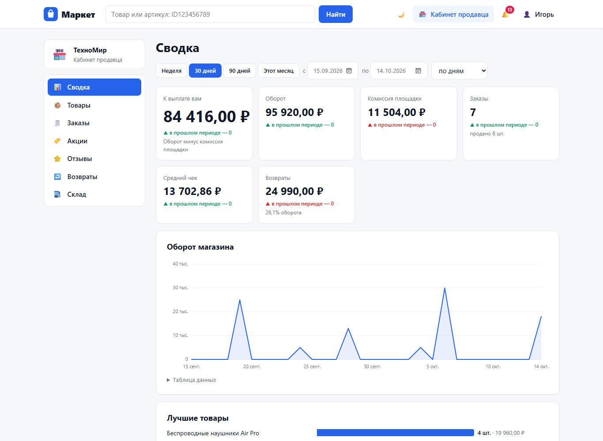
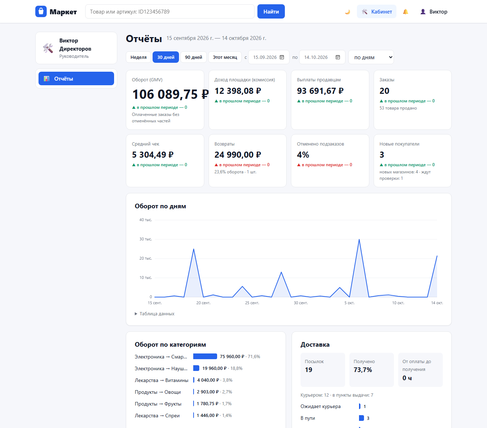
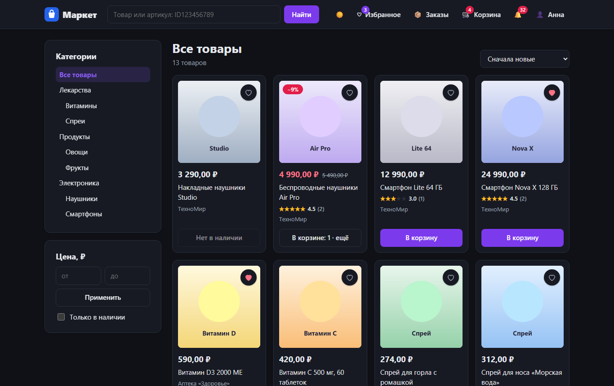
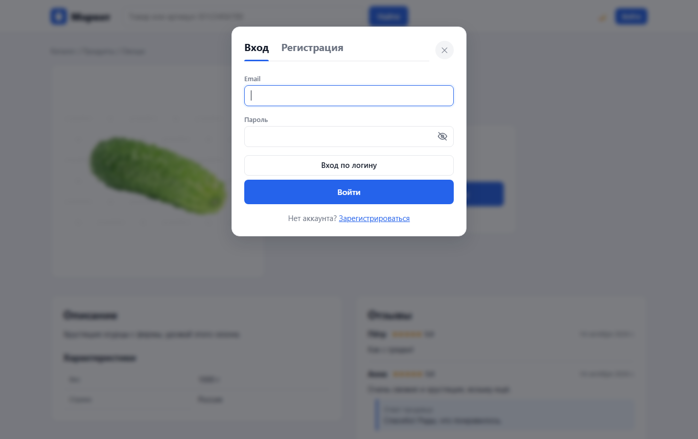
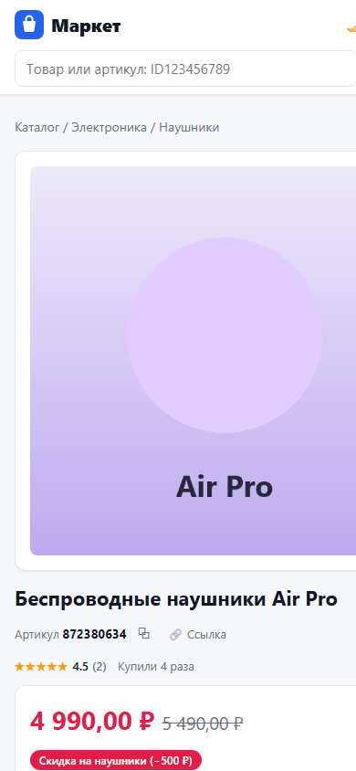

# Маркет — АИС Marketplace

Учебный проект (3 курс): **автоматизированная информационная система «Marketplace»** — веб-приложение электронной торговой площадки, где несколько независимых продавцов продают товары покупателям, а персонал площадки обеспечивает склад, доставку и контроль.

Система автоматизирует полный цикл продажи:
**размещение товара → поиск → заказ → оплата → сборка → доставка → получение → отзыв или возврат.**



## Возможности

| Роль | Что умеет |
|---|---|
| Гость | Каталог с многоуровневыми категориями, поиск по названию и артикулу (`ID123456789`), фильтры, сортировка, карточка товара, отзывы |
| Покупатель | Регистрация по email или логину, корзина, заказ (курьером или в пункт выдачи), оплата с баланса, отслеживание доставки, отмена, отзывы, возвраты, избранное, уведомления |
| Продавец | Товары с галереей до 10 фото и характеристиками, обработка своих подзаказов, акции, ответы на отзывы, возвраты, остатки, статистика продаж |
| Менеджер | Проверка продавцов, доставки, модерация отзывов, решения по возвратам, акции площадки |
| Сотрудник склада | Приём поставок, сборка заказов, журнал движения товара, инвентаризация, приёмка возвратов |
| Курьер | Свободные посылки, доставка, вручение по коду получения |
| Сотрудник ПВЗ | Приёмка посылок, выдача по коду, возврат невостребованных |
| Руководитель | Отчёты: показатели за период, оборот по дням, категориям, продавцам и товарам, выгрузка в CSV |
| Администратор | Пользователи и сотрудники, пополнение балансов (имитация оплаты), справочники в админ-панели |

Особенности реализации:

- **заказ делится на подзаказы продавцов** — каждый продавец видит и обрабатывает только свою часть, без контактов покупателя;
- **оплата — учебная имитация**: у покупателя внутренний баланс, его пополняет администратор, заказ оплачивается списанием;
- **комиссия площадки** задаётся по категориям (наследуется подкатегориями), **акции** — процентом или суммой на товары и категории;
- **история и журналы**: каждая смена статуса заказа, доставки и возврата, каждое движение товара на складе и денег на балансе записываются;
- **интерфейс** на собственных стилях (без UI-библиотек): светлая и тёмная темы, адаптивная вёрстка, вход и регистрация в окне поверх страницы.

## Скриншоты

| Карточка товара | Корзина по продавцам |
|---|---|
|  |  |
| **Отслеживание заказа** | **Кабинет продавца** |
|  |  |
| **Отчёты руководителя** | **Тёмная тема** |
|  |  |
| **Вход поверх страницы** | **Смартфон** |
|  |  |

## Технологии

- **Сервер:** Python 3.14, Django 6.1, Django REST Framework 3.18, Simple JWT, django-filter, drf-spectacular (Swagger)
- **База данных:** PostgreSQL 18 (без настроек — SQLite)
- **Клиент:** React 19, React Router 7, Vite 8, собственные стили (CSS Modules)

## Запуск

Нужны **Python 3.14**, **Node.js 24** и (по желанию) **PostgreSQL 18**.

### 1. Настройки

Скопируйте `.env.example` в `.env` и укажите свои значения. Если строку `DB_NAME` убрать, проект работает с SQLite и PostgreSQL не нужен.

Для PostgreSQL создайте пользователя и базу (в `psql`):

```sql
CREATE ROLE marketplace WITH LOGIN PASSWORD 'пароль' CREATEDB;
CREATE DATABASE marketplace OWNER marketplace;
```

`CREATEDB` нужен, чтобы автотесты могли создавать временную базу.

### 2. Сервер (Django)

```bash
python -m venv .venv
.venv\Scripts\activate          # Windows; в Linux/macOS: source .venv/bin/activate
pip install -r backend/requirements.txt
cd backend
python manage.py migrate
python manage.py createsuperuser
python manage.py runserver
```

### 3. Клиент (React) — в отдельной консоли

```bash
cd frontend
npm install
npm run dev
```

Откройте:

- сайт — http://localhost:5173
- админ-панель — http://127.0.0.1:8000/admin/
- документация API (Swagger) — http://127.0.0.1:8000/api/docs/

Сотрудников (менеджер, склад, курьер, ПВЗ, руководитель) создаёт администратор в кабинете «Пользователи». Баланс покупателю пополняется в админ-панели: «Оплата» → «Операции по балансу» → «Добавить».

## Тесты

```bash
cd backend
python manage.py test
```

129 автотестов: API всех ролей, бизнес-правила, права доступа и сквозной сценарий полного цикла продажи.

## Обслуживание

```bash
python manage.py backup                      # резервная копия в backend/backups/ (JSON, UTF-8)
python manage.py loaddata <файл копии>       # восстановление (в базу после migrate)
python manage.py return_expired_deliveries   # вернуть на склад посылки, не полученные в ПВЗ в срок
```

## Структура

```
backend/                  сервер (Django)
├── marketplace/          настройки, маршруты, права доступа, обработка ошибок
├── users/                пользователи, роли, вход по email и логину
├── catalog/              категории, товары, фото, характеристики, избранное
├── cart/  orders/        корзина, заказы и подзаказы продавцов
├── payments/             баланс и платежи
├── delivery/             доставка и пункты выдачи
├── warehouse/            склад и журнал движения товара
├── reviews/  returns/    отзывы и возвраты
├── promotions/           акции
├── reports/              отчёты, резервное копирование
├── notifications/        уведомления
└── locale/               дополнительные русские переводы
frontend/src/             клиент (React)
├── api/                  запросы к серверу
├── components/           общие компоненты
├── context/              состояние: вход, корзина, избранное, сообщения
├── pages/                страницы покупателя, seller/ — кабинет продавца, staff/ — кабинеты персонала
└── index.css             дизайн-система и темы
```

## Автор

romantkac53-byte — учебный проект, 3 курс.

## Лицензия

MIT — см. файл [LICENSE](LICENSE).
